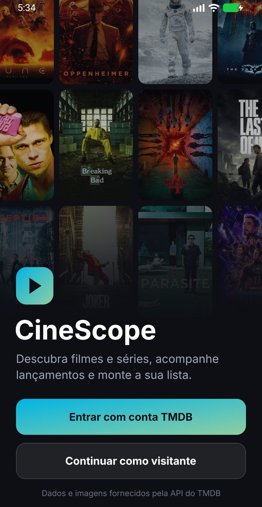
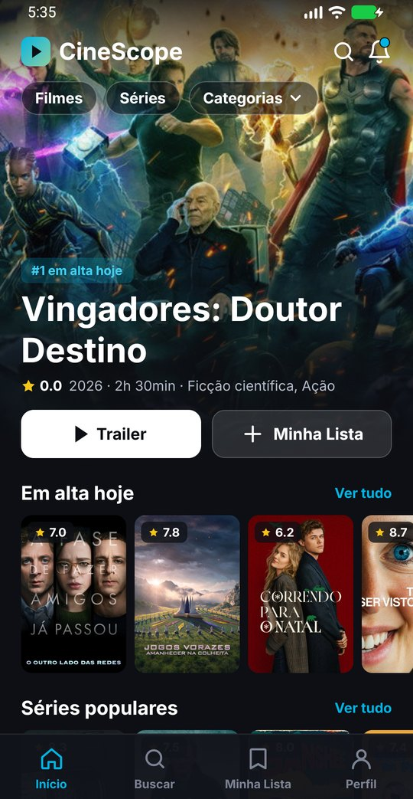
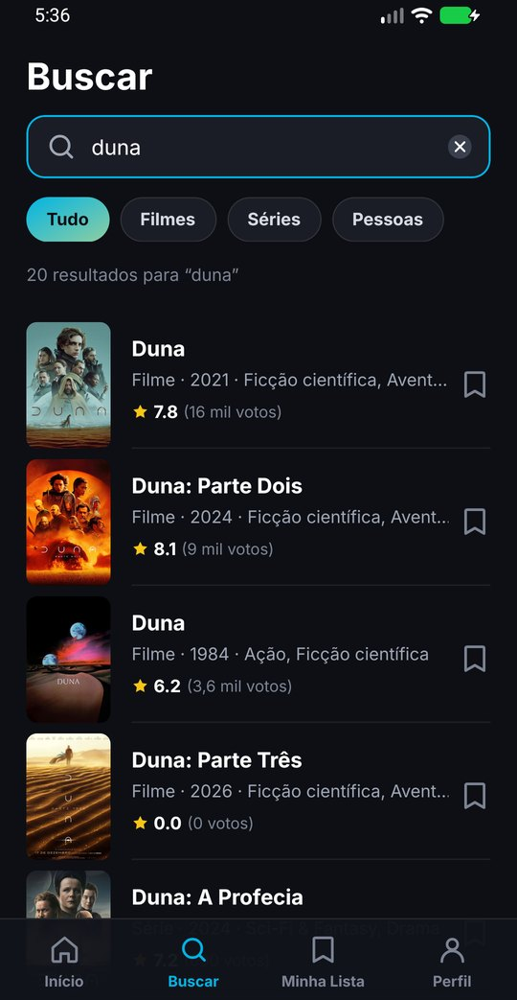
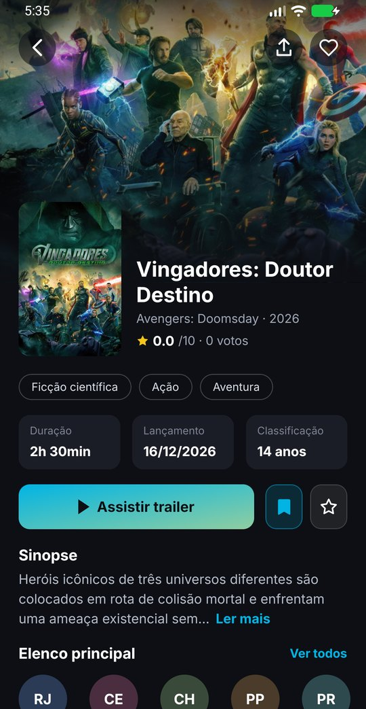
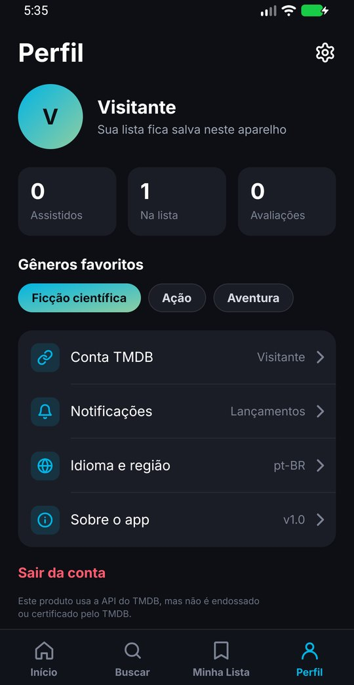

# CineScope

Aplicativo móvel para descobrir filmes e séries, consultar detalhes e montar uma lista pessoal, com dados da API do [The Movie Database (TMDB)](https://www.themoviedb.org/).

Trabalho prático de Desenvolvimento de Aplicações Móveis, Sistemas de Informação, PUC Minas Betim, 2º semestre de 2026.

- **Repositório:** https://github.com/otavio-castro/cinescope
- **Protótipo:** https://www.figma.com/design/NlY4yj1pHKJjf1ujgQPb6W/CineApp

## Integrantes

- Gustavo Rodrigues de Almeida
- Marlon Magalhães Carvalho
- Moisés Samuel Rezende Maia
- Otávio Nascimento de Castro
- Sarah Palhares Araújo

## Telas

| Entrada | Início | Buscar |
|:---:|:---:|:---:|
|  |  |  |

| Detalhe | Minha Lista | Perfil |
|:---:|:---:|:---:|
|  |  |  |

## Como executar

Pré-requisitos: Node.js 22 ou superior e o **Expo Go com suporte ao SDK 58** no celular, conectado à mesma rede Wi-Fi do computador.

1. Instale as dependências:

   ```bash
   npm install
   ```

2. Crie um token gratuito do TMDB em https://www.themoviedb.org/settings/api e copie o **API Read Access Token**.

3. Copie `.env.example` para `.env` e preencha o token:

   ```
   EXPO_PUBLIC_TMDB_TOKEN=seu_token
   ```

4. Inicie o projeto e leia o QR Code com o Expo Go:

   ```bash
   npx expo start --clear
   ```

Se o celular não encontrar o computador, use `npx expo start --tunnel`.

O `.env` não é versionado. Variáveis `EXPO_PUBLIC_` são incorporadas ao aplicativo compilado, por isso o token não deve ser reutilizado em outros projetos.

## Requisitos da disciplina

| Requisito | Onde está |
|---|---|
| React Native com Expo | Expo SDK 58 com TypeScript |
| Três telas ou mais, com navegação | `src/navegacao` e `src/telas` |
| FlatList | Início, Buscar, Minha Lista, Detalhe, Catálogo e Elenco |
| API com carregamento e erro | `src/servicos/tmdbService.ts`, `src/hooks/useRequisicao.ts` e `src/componentes/EstadoTela.tsx` |
| Context API | `src/contextos/AuthContext.tsx` e `src/contextos/ListaContext.tsx` |
| Persistência | AsyncStorage em `src/servicos/storageService.ts` |
| Opcional | Splash própria |

## Arquitetura

```
src/
├── telas/         telas do aplicativo
├── componentes/   elementos visuais reutilizáveis
├── hooks/         lógica de cada tela e requisições
├── contextos/     estado compartilhado (sessão e Minha Lista)
├── servicos/      API do TMDB e AsyncStorage
├── navegacao/     pilha principal e abas
├── tema/          cores, fontes e medidas do protótipo
├── tipos/         modelos de dados
└── utils/         formatação de textos
```

- As telas usam hooks e contextos; somente a camada de serviços conhece a API e o armazenamento.
- A Minha Lista é gravada no aparelho a cada mudança. Com conta TMDB, cada alteração entra em uma fila de pendências e é enviada à watchlist; se a rede falhar, o envio é refeito na próxima sincronização.
- Cada conta tem a própria lista local, separada da lista do visitante.
- A busca espera 400 ms sem digitação antes de consultar a API.

## Bibliotecas

| Biblioteca | Uso |
|---|---|
| `@react-navigation/native`, `native-stack`, `bottom-tabs` | Pilha principal e barra de abas |
| `react-native-screens`, `react-native-safe-area-context` | Dependências da navegação e respeito às áreas do sistema |
| `@react-native-async-storage/async-storage` | Persistência da sessão e da lista |
| `expo-web-browser`, `expo-linking` | Autorização da conta TMDB e abertura do trailer |
| `react-native-svg` | Ícones do protótipo |
| `expo-linear-gradient` | Gradientes do protótipo |
| `expo-font`, `@expo-google-fonts/inter` | Fonte Inter |
| `expo-splash-screen`, `expo-status-bar` | Tela de abertura e barra de status |

Todas são instaladas pelo `npm install`, sem configuração adicional.

## Atribuição

Este produto usa a API do TMDB, mas não é endossado ou certificado pelo TMDB.
